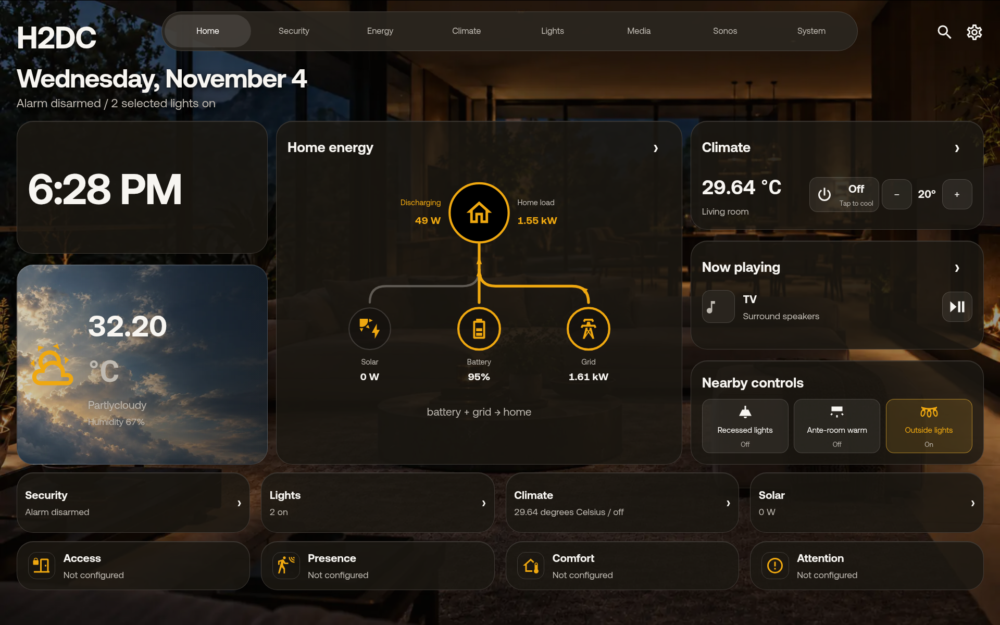
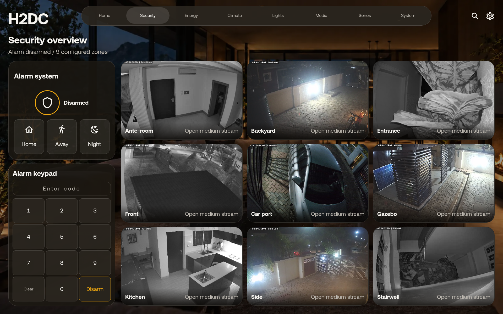
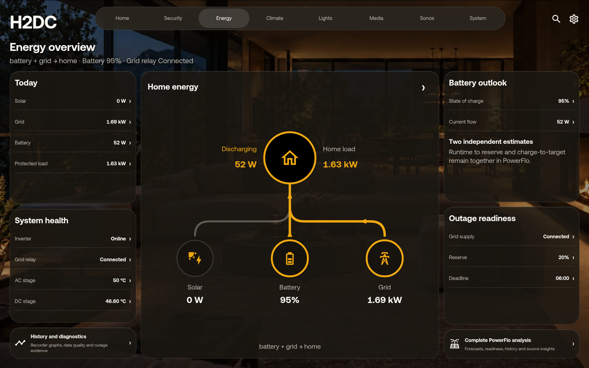
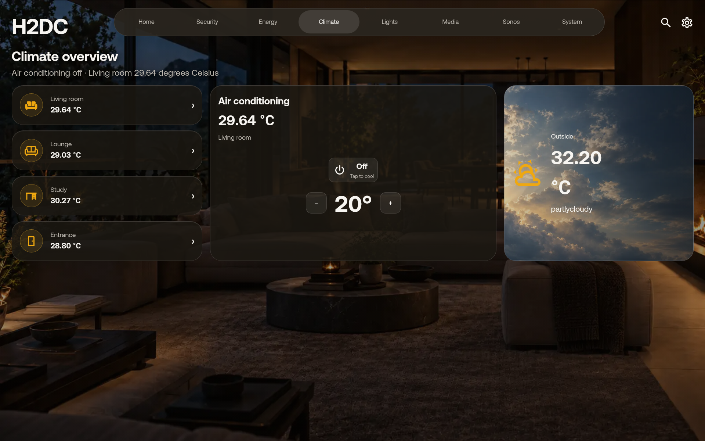
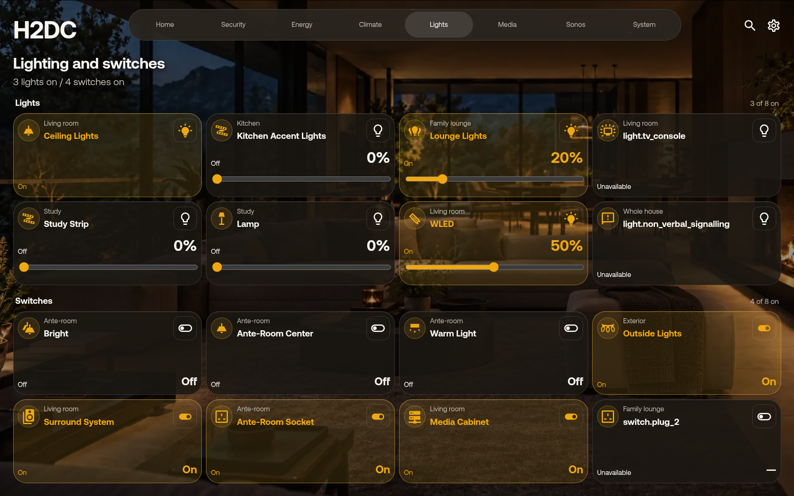
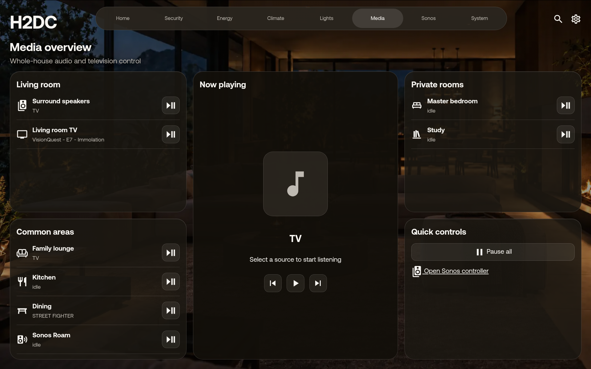
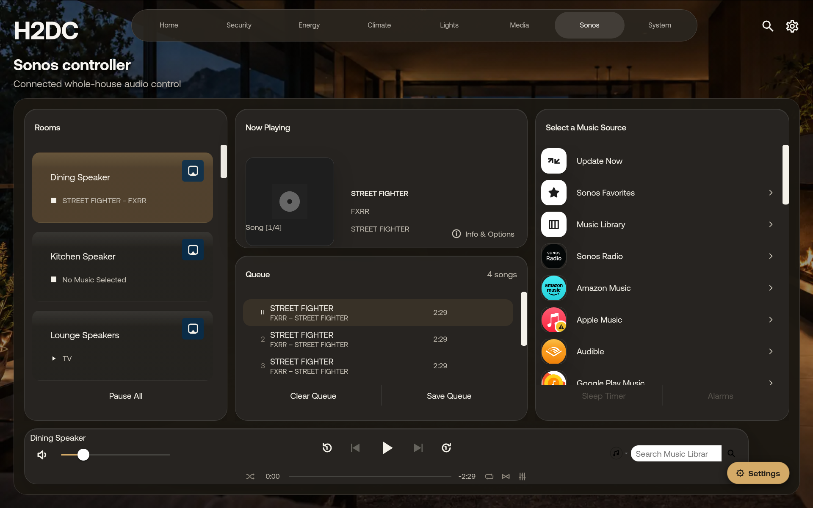
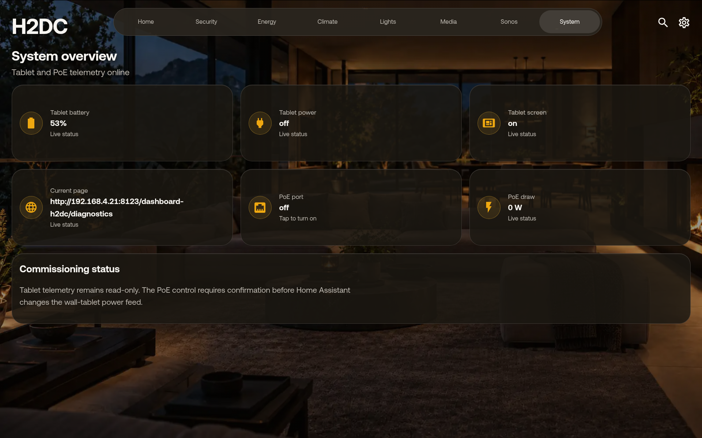

# H2DC Dashboard

A nine-view Home Assistant dashboard for wall-mounted 16:10 tablets. H2DC brings security, live energy flow, EV charging, climate, lighting, media, and kiosk diagnostics into one configurable card without embedding household entity IDs in the package. An optional Sonora view can be added by users who already run Sonora.

[](https://github.com/flexyneat/h2dc-dashboard/releases/latest)
[](https://github.com/flexyneat/h2dc-dashboard/actions/workflows/hacs.yml)
[](https://github.com/flexyneat/h2dc-dashboard/actions/workflows/verify.yml)
[](LICENSE)



> **Release status:** HACS-compatible stable release. The production bundle and all eight routes have passed isolated 1920 × 1200 tablet acceptance. Every installation supplies its own entities, backgrounds, labels, and optional integrations through the visual editor or YAML.

## What H2DC provides

- **Home:** time, current weather, whole-house status, live energy flow, climate, now playing, nearby controls, and contextual summary cards.
- **Security:** alarm controls, masked keypad, and a no-scroll nine-camera overview with focused medium-stream playback.
- **Energy:** animated solar, battery, grid, and protected-load flow with focused detail surfaces and optional Complete PowerFlo analysis.
- **EV Charging:** optional live connector state, power, electrical telemetry, active-session totals, and recent charging history from mapped OCPP entities.
- **Climate:** room conditions, set-point controls, outdoor weather, and condition-aware imagery.
- **Lights:** curated light and switch sections, capability-aware dimmers, and full-card touch targets.
- **Media:** grouped Sonos and television endpoints with live metadata, transport controls, and album artwork when available.
- **Sonos:** an optional embedded Sonora controller for installations that already use Sonora; omit this view when Sonora is not part of the home.
- **System:** kiosk health, battery and charging state, network status, PoE control, and operator diagnostics.

H2DC renders read-only state until the user deliberately interacts with a control. Runtime validation rejects malformed entity IDs, unsafe URLs, invalid numeric service data, and unsupported actions before Home Assistant receives a service call.

## Gallery

### Security and energy

| Security | Energy |
| --- | --- |
| [](docs/images/security.png) | [](docs/images/energy.png) |

### Climate and lighting

| Climate | Lights and switches |
| --- | --- |
| [](docs/images/climate.png) | [](docs/images/lights.png) |

### Media and Sonos

| Media | Sonora controller |
| --- | --- |
| [](docs/images/media.png) | [](docs/images/sonos.png) |

### System

[](docs/images/system.png)

The gallery is captured directly from the commissioned tablet at its native **1920 × 1200** resolution. Values and media shown in screenshots are live examples, not package defaults.

## Requirements

- Home Assistant **2026.10.0 or newer**.
- HACS with Dashboard repositories enabled, or manual Lovelace resource installation.
- A modern browser or Android System WebView; Fully Kiosk Browser is recommended for wall tablets.
- [PowerFlo](https://github.com/flexyneat/PowerFlo) 0.5.0 or a compatible later release only when Complete PowerFlo analysis is enabled.

Sonora is not required. Home, Media, and every other H2DC view work without it; the optional Sonos view can simply be left unconfigured.

## Install with HACS

H2DC is currently installed as a custom HACS Dashboard repository:

1. Open **HACS → Dashboard**.
2. Open the three-dot menu and choose **Custom repositories**.
3. Add `https://github.com/flexyneat/h2dc-dashboard` with category **Dashboard**.
4. Install the latest tagged release.
5. Confirm `/hacsfiles/h2dc-dashboard/h2dc-dashboard.js` is registered as a JavaScript module under **Settings → Dashboards → Resources**.
6. Add a manual card with type `custom:h2dc-dashboard-card` to a temporary dashboard.
7. Map the required entities in the visual editor before enabling the dashboard on a kiosk.

See the full [installation and integrity guide](docs/INSTALLATION.md) before changing a production tablet's start URL.

## Minimal configuration

```yaml
type: custom:h2dc-dashboard-card
view: home
config_version: 2
dashboard_path: /wall
entities:
  alarm: alarm_control_panel.house
  climate: climate.living_room
  weather: weather.home
  room_temperature: sensor.living_room_temperature
  lights:
    - entity: light.living_room
      room: Living room
      icon: mdi:ceiling-light
  switches:
    - entity: switch.outside_lights
      room: Exterior
      icon: mdi:string-lights
  energy:
    freshness: binary_sensor.inverter_fresh
    solar: sensor.solar_power
    battery_soc: sensor.battery_soc
    battery: sensor.battery_power
    grid: sensor.grid_power
    load: sensor.home_load
battery_positive_is: discharge
grid_positive_is: import
flow_threshold_w: 40
backgrounds:
  day: /local/h2dc/day.webp
  night: /local/h2dc/night.webp
  per_view:
    security: /local/h2dc/security.webp
presentation:
  font_family: Aeonik Pro
  kiosk_profile: wall_16_10
```

The editor and schema support reusable rooms, per-view backgrounds, presentation density, House Pulse summaries, camera mappings, grouped media players, optional Sonora integration, kiosk diagnostics, PowerFlo telemetry, and installation-specific labels. Review the complete [configuration reference](docs/CONFIGURATION.md) rather than copying entity IDs from the screenshots.

## Preview and configure EV Charging

H2DC is a dashboard client, not an OCPP Charging Station Management System (CSMS). The complete path is:

```text
EV charger → OCPP WebSocket → compatible CSMS or Home Assistant integration → Home Assistant entities → H2DC
```

The EV Charging tab stays hidden until `entities.ocpp.status` is mapped. This prevents an installation without a charger from showing empty controls.

### Preview without a charger

The production and isolated preview cards can render the same deterministic, read-only charging session. Enable it in the visual editor under **EV Charging → Simulation mode**, or add the public flag:

```yaml
type: custom:h2dc-dashboard-card
view: charging
ev_charging_demo: true
```

The simulator shows a 7.40 kW active charge, connector telemetry, accumulated energy, and four example sessions. It is labelled **Simulated preview**, contains no `charge_control` mapping, and cannot issue a charger command. Turn simulation off before commissioning a real charger; mapped entities then become authoritative.

### 1. Establish the charger connection

1. Confirm the exact protocol offered by the charger: OCPP 1.6J, OCPP 2.0.1, or OCPP 2.1. Do not assume these are interchangeable—OCPP 2.0.1 is not backward compatible with 1.6.
2. Select a CSMS or Home Assistant integration that explicitly supports that protocol and the charger's authentication method. H2DC does not bundle or select a CSMS.
3. Give the charger a stable DHCP reservation, correct time/NTP settings, and reliable LAN access.
4. In the charger interface, enter the WebSocket endpoint and charge-point identity exactly as required by the selected CSMS. Typical endpoints use `ws://` on a trusted local network or `wss://` with TLS; the precise path and identity format are integration-specific.
5. Configure the required Basic Auth, token, client certificate, or other credential on both ends. Never expose an unauthenticated OCPP WebSocket to the public internet.
6. Confirm in the CSMS that the charger reaches `Available` before adding H2DC.
7. Add the compatible integration under **Settings → Devices & services** and verify that its charger entities update in Home Assistant.

### 2. Map the Home Assistant entities

Only `status` is required to reveal the tab. Every other measurement is optional and renders as **Unavailable** when it is absent.

```yaml
entities:
  ocpp:
    status: sensor.ev_charger_status
    power: sensor.ev_charger_power
    session_energy: sensor.ev_charger_session_energy
    total_energy: sensor.ev_charger_total_energy
    current: sensor.ev_charger_current
    voltage: sensor.ev_charger_voltage
    temperature: sensor.ev_charger_temperature
    session_duration: sensor.ev_charger_session_duration
    transaction_id: sensor.ev_charger_transaction_id
    connector_id: sensor.ev_charger_connector_id
    error_code: sensor.ev_charger_error_code
    session_history: sensor.ev_charger_session_history
    maximum_current: number.ev_charger_maximum_current
    availability: binary_sensor.ev_charger_available
    charge_control: switch.ev_charger
```

| Mapping | Expected domain and unit | Purpose |
| --- | --- | --- |
| `status` | Any entity with a connector lifecycle state | Required capability gate; accepts common 1.6J and 2.x state names. |
| `power` | Sensor in W or kW | Instantaneous charging power. |
| `session_energy` | Sensor in Wh or kWh | Energy delivered in the active transaction. |
| `total_energy` | Sensor in Wh, kWh, or MWh | Lifetime delivered energy. |
| `current` | Sensor in A or mA | Live connector current. |
| `voltage` | Sensor in V or kV | Live connector voltage. |
| `temperature` | Sensor in °C or C | Charger temperature when exposed. |
| `session_duration` | Sensor in s, sec, min, or h | Active-session duration, normalized to minutes. |
| `transaction_id` / `connector_id` / `error_code` | Text or sensor entity | Transaction and connector diagnostics. |
| `availability` | Binary sensor | Charger connectivity or operational availability. |
| `maximum_current` | Number or sensor in A | Displayed configured limit; H2DC does not change it. |
| `charge_control` | Switch | Optional start/stop boundary; add only after physical acceptance. |

### 3. Provide session history

Map `session_history` to an entity with a `sessions` or `recent_sessions` attribute. Each array item may contain:

```yaml
sessions:
  - id: transaction-2048
    started_at: "2026-11-10T08:19:00+01:00"
    stopped_at: "2026-11-10T10:50:00+01:00"
    energy_kwh: 18.62
    duration_minutes: 151
    stop_reason: EV disconnected
```

Equivalent camel-case keys (`transactionId`, `startedAt`, `stoppedAt`, `energyKwh`, `durationMinutes`, `stopReason`) are also accepted. H2DC displays up to four recent sessions and does not fabricate missing history. Use a template sensor or companion integration if the selected OCPP integration does not expose a durable session list.

### 4. Commission safely

1. Confirm the lifecycle sequence `Available → Preparing/EVConnected → Charging → Finishing → Available` using a real vehicle.
2. Compare displayed power, voltage, current, and session energy with the charger or a trusted meter; correct the source entity or its unit rather than adding a display-only multiplier.
3. Disconnect the network and confirm the tab reports offline or unavailable instead of zero.
4. Exercise a fault and confirm the real `error_code` is shown.
5. Keep `charge_control` unmapped during read-only acceptance. Map it only after verifying the exact switch starts and stops the intended connector and the charger retains its local safety protections.
6. Test on the isolated dashboard before copying the mapping to a production kiosk.

If the tab remains hidden, verify that `status` is configured on every H2DC card used by the dashboard and that its entity ID exists. If a metric is unavailable, check its unit against the table above. If the charger never connects, resolve its WebSocket URL, identity, credentials, TLS trust, firewall, and OCPP-version compatibility at the CSMS layer before troubleshooting H2DC.

## Customize safely

| Area | Configure | Important boundary |
| --- | --- | --- |
| Backgrounds | Global day/night images and per-view overrides | Only `/local/`, `/media/`, HTTPS, and `data:image/` sources are accepted. |
| Energy | Entity mappings, polarity, flow threshold, PowerFlo options | H2DC does not send inverter commands. |
| EV Charging | Normalized OCPP entity mappings and optional session history | The route is hidden without `status`; remote control is opt-in and switch-only. |
| Cameras | Up to nine overview entities and dedicated medium-stream entities | Opening one camera starts only its selected stream. |
| Lights | Up to eight curated lights and eight curated switches | Keep administrative, PoE, and camera-analysis switches out of household controls. |
| Media | Named room groups and fallback players | Artwork uses Home Assistant media metadata first; Sonora is an optional fallback. |
| Kiosk | Fully Kiosk entities, battery sensor, and tablet PoE switch | Wake and charging automation remain separate, opt-in commissioning tasks. |

Optional automation blueprints cover presence lighting, sensor overlap migration, tablet charging windows, and kiosk wake. Every blueprint is selector-driven and contains no household entity IDs. See the [blueprint library](docs/BLUEPRINTS.md).

## Architecture and security

H2DC is a strict-TypeScript Lovelace custom card compiled into one deterministic public bundle. Configuration is parsed at the boundary before rendering or action dispatch. The runtime package excludes commissioned household configuration, private source assets, hostnames, secrets, operating logs, and preview-only artifacts; the repository gallery contains only the operator-approved tablet captures shown above.

Key guarantees:

- no production dependencies in the browser bundle;
- no hidden entity discovery or household defaults;
- explicit allowlists for climate, media, alarm, and infrastructure actions;
- finite-value checks for numeric service data;
- escaped dynamic text and validated image/background URLs;
- reduced-motion support and designed unavailable/stale states;
- keyboard focus restoration and Escape dismissal for dialogs;
- medium-stream camera policy for focused playback;
- separate public and isolated-preview custom-element registrations.

For configuration boundaries and trust controls, use the [configuration guide](docs/CONFIGURATION.md) and [Security acceptance matrix](docs/SECURITY_PORT_ACCEPTANCE_MATRIX.md).

## Development

```bash
npm install
npm run verify
npm run verify:release
```

The project uses:

1. **Build system:** Vite 8 with deterministic library output.
2. **Frontend:** native Home Assistant custom elements written in strict TypeScript 5.9.
3. **Backend:** none; H2DC consumes the authenticated Home Assistant frontend state object.
4. **Database:** none; history and statistics remain owned by Home Assistant Recorder.
5. **Authentication:** the active Home Assistant session.
6. **Testing:** Vitest 4 plus TypeScript, distribution-isolation, HACS, and release-artifact gates.
7. **Distribution:** HACS-compatible GitHub releases with checksums and build provenance.

The build emits:

- `dist/h2dc-dashboard.js` — the release asset declared by `hacs.json`;
- `dist/h2dc-dashboard-preview.js` — an isolated acceptance build that cannot register the production custom-element tag.

`npm run verify:release` checks the HACS filename and layout, semantic version, custom-element identity, preview isolation, and distributable SHA-256 digest.

## Documentation

- [Installation](docs/INSTALLATION.md)
- [Configuration reference](docs/CONFIGURATION.md)
- [Upgrade and rollback](docs/UPGRADING.md)
- [Clean-install rehearsal](docs/CLEAN_INSTALL_REHEARSAL.md)
- [Blueprint library](docs/BLUEPRINTS.md)
- [Sensor migration runbook](docs/SENSOR_MIGRATION.md)
- [Acceptance record](docs/ACCEPTANCE.md)
- [Energy acceptance matrix](docs/ENERGY_PORT_ACCEPTANCE_MATRIX.md)
- [Security acceptance matrix](docs/SECURITY_PORT_ACCEPTANCE_MATRIX.md)
- [Product roadmap](docs/PRODUCT_ROADMAP.md)
- [Changelog](CHANGELOG.md)

## Release and support policy

- Install tagged releases on commissioned tablets; do not point production kiosks at `main`.
- Verify `SHA256SUMS` and the GitHub build-provenance attestation before commissioning.
- Test upgrades on a temporary dashboard and retain the prior resource URL for rollback.
- Report reproducible defects through [GitHub Issues](https://github.com/flexyneat/h2dc-dashboard/issues) without attaching secrets, private camera images, or complete Home Assistant configuration exports.

## License

H2DC Dashboard is available under the [MIT License](LICENSE). Third-party products and integrations retain their own names, trademarks, and licenses.
